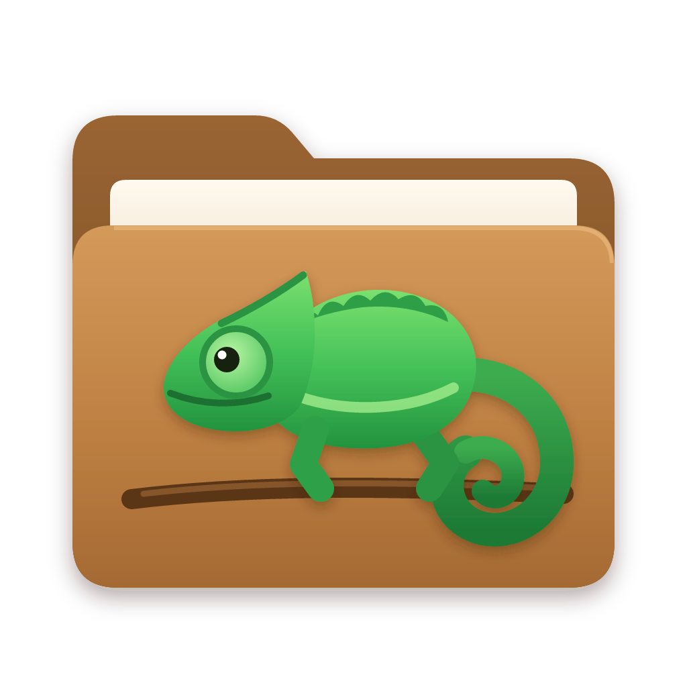

<p align="center">
  
</p>

<h1 align="center">File Chameleon</h1>

<p align="center">
  Convert files offline, download media from links and get smart clipboard suggestions,<br>
  all in one small, fast Windows app.
</p>

<p align="center">
  <a href="README.tr.md">Türkçe</a> ·
  <a href="#features">Features</a> ·
  <a href="#install">Install</a> ·
  <a href="#build-from-source">Build</a> ·
  <a href="#privacy">Privacy</a>
</p>

---

## Features

### Convert: offline, on your PC

Drop files on the window, or **hold Ctrl while dragging files** anywhere. A format wheel opens under
your cursor: release on a format and the conversion runs in the background. Your files never leave
your computer, and the originals are never changed or deleted.

| Kind | Formats |
|---|---|
| Images | PNG, JPG, WebP (lossy and lossless), BMP, GIF, TIFF, ICO (multi-size); SVG → PNG/JPG/WebP/ICO |
| Video | MP4, MKV, WebM, MOV, AVI; video → GIF; GIF → MP4/WebM; extract audio |
| Audio | MP3, M4A, Opus/OGG, FLAC, WAV |
| PDF | merge, split, images → PDF, PDF → PNG/JPG |
| Data | Markdown → HTML, TXT → HTML, CSV ⇄ JSON ⇄ YAML ⇄ TOML |

Media tools: **compress** (by quality or target size), **trim**, **mute**, **speed** and **crop**.

When you drop several files of different types, only the formats that work for all of them are shown.

### Download media from links

Paste a link from YouTube, Instagram (reels and posts), TikTok, X/Twitter, Facebook, Reddit, Vimeo,
Twitch clips, Pinterest, or a direct image or video URL. You can save it as video (MP4), audio (MP3),
GIF or the original file, at Best, 1080p or 720p. After it finishes, you can show it in its folder or
convert it in one click.

### Smart clipboard

- Copy a media link and File Chameleon offers to download it.
- Copy an image and it offers to save or convert it.
- A small shelf keeps your recent clips, with search and pinning.
- Content that password managers mark as private is never recorded.
- You can pause the clipboard history at any time.

### Light by design

- **Small installer.** Heavy engines (FFmpeg, yt-dlp, PDFium) are downloaded only the first time a
  feature needs them, and each download is SHA-256 verified. An FFmpeg already on your `PATH` is
  used as is.
- **Low memory.** The background work (tray, Ctrl+drag hook, clipboard watcher, job queue) runs in
  Rust. The main window is destroyed when you close it and rebuilt when you open it.
- **Native feel.** Windows 11 Mica, macOS-style window controls, the Inter font and Lucide icons. It
  follows light and dark mode, and the interface is in Turkish and English.

## Install

Download the latest `File Chameleon_x.y.z_x64-setup.exe` from
[Releases](../../releases) and run it. It installs for your user only, so no admin rights are needed.
Each installer has a matching `.sha256` file you can use to check the download.

Requirements: Windows 10 (1809+) or Windows 11, 64-bit. WebView2 is installed automatically if it
is missing.

## Usage tips

- **Ctrl + drag** files from File Explorer or the desktop to open the format wheel. Press **Esc** or
  release outside the wheel to cancel.
- Closing the window keeps File Chameleon in the tray. Use **Quit** in the tray menu to exit.
- Settings → **Engines** shows which engines are installed and lets you update or remove them.
- Settings → **Wheel** lets you turn the wheel off, or allow it in every app instead of only File
  Explorer and the desktop.

## Build from source

You need [Rust](https://rustup.rs) (stable, 1.88 or newer), [Node.js](https://nodejs.org) 22 or
newer, and the WebView2 runtime.

```powershell
npm ci
npm run tauri dev      # run in development
npm run tauri build    # build the NSIS installer into target/release/bundle/nsis
```

Checks:

```powershell
cargo test --workspace
cargo clippy --workspace --all-targets -- -D warnings
npm run check
npm run test
```

Project layout:

```
crates/fc-core/   core logic: formats, conversion engines, job queue, engine manager,
                  downloader, clipboard history (no UI code)
src-tauri/        desktop shell: windows, tray, Ctrl+drag hook, clipboard watcher, IPC
src/              Svelte 5 interface: main window (index.html) and wheel/toast overlay (overlay.html)
```

## Privacy

- Conversions run entirely on your computer.
- The app connects to the internet only to download media you ask for, and to download or update
  an engine (from the official release pages listed in `engines.manifest.json`).
- Copied text is matched against a built-in list of sites. Nothing is sent anywhere when you copy.
- There is no telemetry and no account.

## Responsible use

Download only content you have the right to save. Respect the terms of the sites you use and the
rights of creators. You are responsible for how you use the downloader.

## Credits

Inspired by [Filee](https://github.com/KnifeLemon/Filee),
[Nashi](https://github.com/orkunisitmak/nashi-app) and
[Clipboardline](https://github.com/orkunisitmak/clipboardline). File Chameleon is an independent
project, is not affiliated with them, and contains none of their code. See
[THIRD_PARTY_NOTICES.md](THIRD_PARTY_NOTICES.md) for the open-source software it uses.

## License

[MIT](LICENSE)
