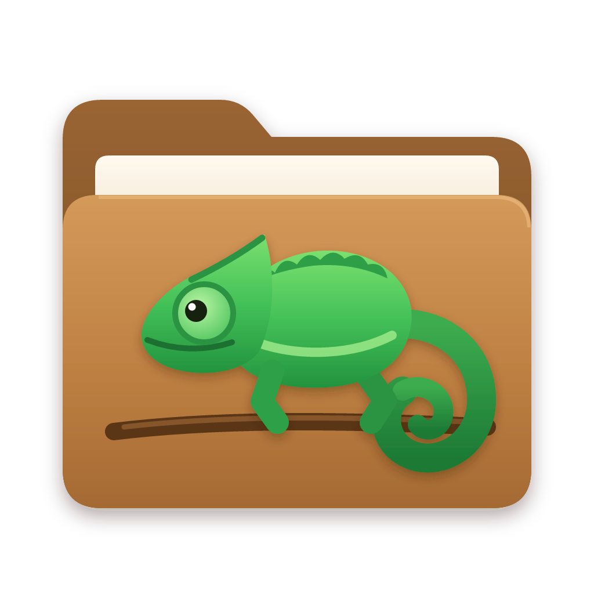

<p align="center">
  
</p>

<h1 align="center">File Chameleon</h1>

<p align="center">
  Dosyaları internetsiz dönüştürün, linklerden medya indirin, panoda akıllı öneriler alın.<br>
  Hepsi tek, küçük ve hızlı bir Windows uygulamasında.
</p>

<p align="center">
  <a href="README.md">English</a> ·
  <a href="#özellikler">Özellikler</a> ·
  <a href="#kurulum">Kurulum</a> ·
  <a href="#kaynaktan-derleme">Derleme</a> ·
  <a href="#gizlilik">Gizlilik</a>
</p>

---

## Özellikler

### Dönüştür: internetsiz, kendi bilgisayarınızda

Dosyaları pencereye bırakın ya da herhangi bir yerde **Ctrl'ye basılı tutarak dosya sürükleyin**.
İmlecin altında bir format çarkı açılır. Bir formatın üstünde bırakınca dönüşüm arka planda yapılır.
Dosyalarınız bilgisayarınızdan çıkmaz, orijinal dosyalar asla değiştirilmez veya silinmez.

| Tür | Formatlar |
|---|---|
| Resim | PNG, JPG, WebP (kayıplı ve kayıpsız), BMP, GIF, TIFF, ICO (çok boyutlu); SVG → PNG/JPG/WebP/ICO |
| Video | MP4, MKV, WebM, MOV, AVI; videodan GIF; GIF'ten MP4/WebM; sesi ayırma |
| Ses | MP3, M4A, Opus/OGG, FLAC, WAV |
| PDF | birleştirme, bölme, resimlerden PDF, PDF'ten PNG/JPG |
| Veri | Markdown → HTML, TXT → HTML, CSV ⇄ JSON ⇄ YAML ⇄ TOML |

Medya araçları: **sıkıştır** (kaliteye veya hedef boyuta göre), **kes**, **sessize al**, **hız** ve **kırp**.

Farklı türde birden çok dosya bırakırsanız sadece hepsine uygun formatlar gösterilir.

### Linkten medya indirme

YouTube, Instagram (reels ve gönderiler), TikTok, X/Twitter, Facebook, Reddit, Vimeo, Twitch klipleri
ve Pinterest linklerini yapıştırabilirsiniz. Doğrudan resim veya video adresleri de olur. Video (MP4),
ses (MP3), GIF veya orijinal dosya olarak, En iyi, 1080p ya da 720p kalitede kaydedebilirsiniz.
İndirme bitince dosyayı klasörde gösterebilir veya tek tıkla dönüştürebilirsiniz.

### Akıllı pano

- Bir medya linki kopyalayınca File Chameleon indirmeyi önerir.
- Bir resim kopyalayınca kaydetmeyi veya dönüştürmeyi önerir.
- Küçük bir raf son kopyaladıklarınızı tutar. Arama ve sabitleme vardır.
- Parola yöneticilerinin gizli olarak işaretlediği içerik asla kaydedilmez.
- Pano geçmişini istediğiniz an duraklatabilirsiniz.

### Hafif olacak şekilde tasarlandı

- **Küçük kurulum.** Ağır motorlar (FFmpeg, yt-dlp, PDFium) bir özellik onlara ilk ihtiyaç duyduğunda
  bir kez indirilir ve SHA-256 ile doğrulanır. Bilgisayarınızda `PATH` içinde FFmpeg varsa doğrudan o
  kullanılır.
- **Az bellek.** Arka plandaki işler (tepsi, Ctrl+sürükle kancası, pano dinleyici, iş kuyruğu) Rust
  ile çalışır. Ana pencere kapatılınca tamamen kapanır, açılınca yeniden oluşturulur.
- **Doğal görünüm.** Windows 11 Mica, macOS tarzı pencere düğmeleri, Inter yazı tipi ve Lucide
  ikonları. Açık ve koyu temaya uyar. Arayüz Türkçe ve İngilizcedir.

## Kurulum

[Releases](../../releases) sayfasından en son `File Chameleon_x.y.z_x64-setup.exe` dosyasını indirip
çalıştırın. Sadece sizin kullanıcınız için kurulur, yönetici izni gerekmez. Her kurulum dosyasının
yanında indirmeyi kontrol etmeniz için bir `.sha256` dosyası vardır.

Gereksinimler: Windows 10 (1809 ve üstü) veya Windows 11, 64 bit. WebView2 yoksa otomatik kurulur.

## Kullanım ipuçları

- Format çarkını açmak için Dosya Gezgini'nden veya masaüstünden dosyaları **Ctrl + sürükleyin**.
  İptal etmek için **Esc**'ye basın ya da çarkın dışında bırakın.
- Pencereyi kapatınca File Chameleon tepside çalışmaya devam eder. Çıkmak için tepsi menüsünde
  **Çıkış**'ı seçin.
- Ayarlar → **Motorlar** bölümü hangi motorların kurulu olduğunu gösterir, güncelleme ve kaldırma
  yapmanızı sağlar.
- Ayarlar → **Çark** bölümünden çarkı kapatabilir veya sadece Dosya Gezgini ve masaüstü yerine tüm
  uygulamalarda açılmasına izin verebilirsiniz.

## Kaynaktan derleme

[Rust](https://rustup.rs) (stable, 1.88 veya üstü), [Node.js](https://nodejs.org) 22 veya üstü ve
WebView2 çalışma zamanı gerekir.

```powershell
npm ci
npm run tauri dev      # geliştirme modunda çalıştır
npm run tauri build    # NSIS kurulumunu target/release/bundle/nsis içine derle
```

Kontroller:

```powershell
cargo test --workspace
cargo clippy --workspace --all-targets -- -D warnings
npm run check
npm run test
```

Proje yapısı:

```
crates/fc-core/   çekirdek mantık: formatlar, dönüştürme motorları, iş kuyruğu, motor yöneticisi,
                  indirici, pano geçmişi (arayüz kodu yok)
src-tauri/        masaüstü kabuğu: pencereler, tepsi, Ctrl+sürükle kancası, pano dinleyici, IPC
src/              Svelte 5 arayüzü: ana pencere (index.html) ile çark ve bildirim katmanı (overlay.html)
```

## Gizlilik

- Dönüştürmeler tamamen bilgisayarınızda yapılır.
- Uygulama internete sadece istediğiniz medyayı indirmek ve bir motoru indirmek veya güncellemek için
  bağlanır. Motorlar `engines.manifest.json` dosyasında listelenen resmi sürüm sayfalarından indirilir.
- Kopyaladığınız metin, uygulamanın içindeki site listesiyle karşılaştırılır. Kopyaladığınızda hiçbir
  yere bir şey gönderilmez.
- Telemetri yoktur, hesap gerekmez.

## Sorumlu kullanım

Sadece kaydetme hakkınız olan içerikleri indirin. Kullandığınız sitelerin kurallarına ve içerik
üreticilerinin haklarına saygı gösterin. İndiriciyi nasıl kullandığınızın sorumluluğu size aittir.

## Teşekkür

[Filee](https://github.com/KnifeLemon/Filee),
[Nashi](https://github.com/orkunisitmak/nashi-app) ve
[Clipboardline](https://github.com/orkunisitmak/clipboardline) projelerinden ilham alındı. File
Chameleon bağımsız bir projedir, onlarla bağlantılı değildir ve onların kodunu içermez. Kullanılan
açık kaynak yazılımlar için [THIRD_PARTY_NOTICES.md](THIRD_PARTY_NOTICES.md) dosyasına bakın.

## Lisans

[MIT](LICENSE)
